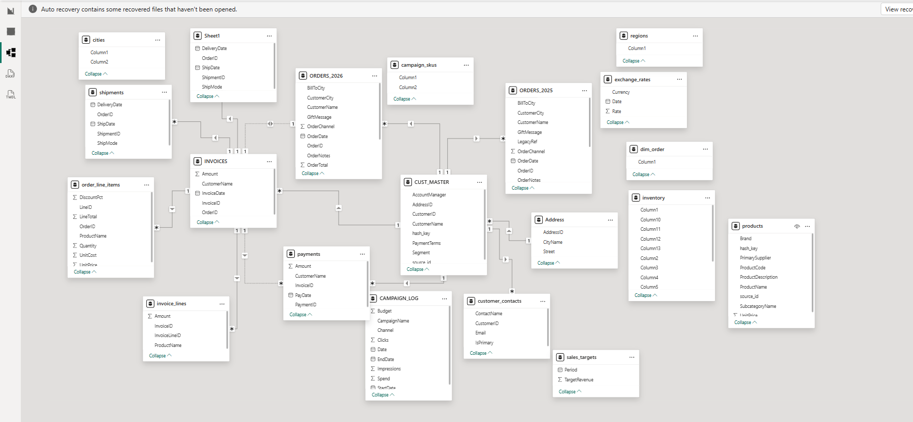
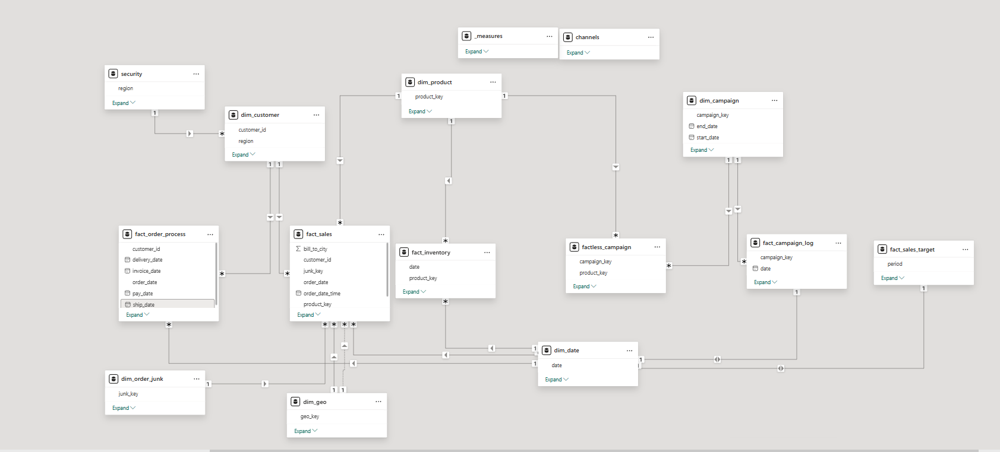
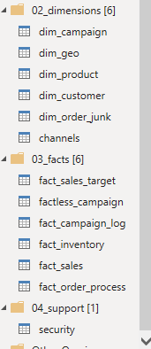

# Power BI Data Modeling: From Complex Source Data to Star Schema

**A hands-on dimensional modeling project using Power BI, Power Query, and DAX.**

Transforming 23 raw source tables into a structured analytical model covering sales, customers, products, inventory, marketing campaigns, and order processing.

## 1. Project Overview

This project focuses on transforming a complex source data model into a structured analytical model using dimensional modeling principles.

Starting with 23 source tables, I used Power Query to clean, merge, append, and reshape data into dedicated fact and dimension tables.

The main objectives were to:

- Apply star schema and dimensional modeling principles.
- Define fact table grain and appropriate relationships.
- Create surrogate keys for analytical entities.
- Separate descriptive attributes from measurable business events.
- Remove redundant tables and unnecessary columns.
- Implement DAX measures and regional Row-Level Security.

> **Project type:** Guided hands-on project documenting practical transformations, modeling decisions, and implementation challenges.

## 2. Business Context

The dataset represents a global B2B business selling products to customers across multiple regions.

It covers several business processes:

| Business Process | Analytical Purpose |
|---|---|
| Sales | Analyze quantities, prices, costs, and revenue |
| Customers | Customer segmentation and regional analysis |
| Products | Product categories and subcategories |
| Inventory | Inventory analysis over time |
| Marketing | Campaign impressions, clicks, and spend |
| Promotions | Campaign-product coverage |
| Sales Planning | Actual sales versus revenue targets |
| Order Processing | Shipping, delivery, invoicing, and payment |
| Access Control | Regional data restrictions |

## 3. Tools & Technologies

| Technology | Application |
|---|---|
| Power BI Desktop | Data modeling |
| Power Query | Data cleaning and transformation |
| DAX | Measures and calculated tables |
| Star Schema | Dimensional modeling |
| Surrogate Keys | Relationship management |
| Row-Level Security | Regional access control |
| Git & GitHub | Version control and documentation |

## 4. Source Data

The project started with 23 source tables.

| Category | Main Source Tables |
|---|---|
| Customers | `CUST_MASTER`, `customer_contacts`, `user_details`, `Address` |
| Products | `products`, `subcategories` |
| Orders & Sales | `ORDERS_2025`, `ORDERS_2026`, `order_line_items` |
| Marketing | `CAMPAIGN_LOG`, `campaign_skus` |
| Geography | `cities`, `regions` |
| Inventory | `inventory` |
| Sales Targets | `sales_targets` |
| Fulfillment | `shipments` |
| Invoices & Payments | `INVOICES`, `invoice_lines`, `payments` |
| Supporting Data | `exchange_rates`, `channels`, `security`, and others |

Not all source tables were retained. Redundant tables were removed, while relevant data was merged into the analytical model.

## 5. Data Modeling Architecture

The final model separates descriptive dimensions, transactional facts, and supporting tables.

### Original Data Model

The original source model contained multiple tables that required restructuring to improve organization, relationships, and analytical usability.



### Final Data Model

The resulting model separates business processes into dedicated fact tables and shared dimensions, following dimensional modeling principles.



### Power Query Organization

Queries were organized into four groups:

| Group | Purpose |
|---|---|
| `01_stage` | Source and staging queries |
| `02_dimensions` | Dimension tables |
| `03_facts` | Fact tables |
| `04_support` | Supporting and security tables |

Naming conventions:

- Table names use lowercase `snake_case`.
- `dim_` and `fact_` prefixes identify table types.
- Column naming was standardized using the project's capitalization convention.



### Modeling Principles

- **Fact and dimension separation:** Descriptive attributes are stored in dimensions, while business events and measurements are stored in facts.
- **Explicit grain:** Each fact table represents a defined business event or measurement.
- **Surrogate keys:** Created `product_key` and `geo_key` to support analytical relationships.
- **Reduced redundancy:** Removed unnecessary columns and duplicate source structures.
- **Controlled filtering:** Organized dimension-to-fact relationships and reviewed relationship cardinality and filter direction.

## 6. Key Data Transformations

### Customer Dimension — `dim_customer`

- Started from `CUST_MASTER`.
- Filtered `customer_contacts` to retain primary contacts.
- Merged relevant customer and user-detail information.
- Removed unnecessary fields such as `hash_key` and `source_id`.
- Checked merge results to avoid unintended row multiplication.

### Product Dimension — `dim_product`

- Removed unnecessary descriptions and source identifiers.
- Split combined category and subcategory information.
- Merged with the subcategory table.
- Created a surrogate key named `product_key`.
- Used product keys in the sales fact instead of product names.

### Sales Preparation & Fact — `fact_sales`

- Appended the 2025 and 2026 order tables.
- Removed unnecessary order attributes.
- Retrieved customer and product identifiers through merges.
- Extracted channel, status, and priority into a junk dimension.
- Replaced descriptive product references with `product_key`.

**Fact grain:** One row per order line item.

Important columns include:

`order_id`, `line_id`, `customer_id`, `product_key`, `order_date`, `quantity`, `unit_price`, `unit_cost`, `discount_pct`, `line_total`, and `junk_key`.

A sample consistency check:

`4 × 636.11 = 2,544.44`

### Order Junk Dimension — `dim_order_junk`

- Extracted order channel, status, and priority.
- Removed duplicate combinations.
- Created a `junk_key`.
- Linked the resulting dimension to the order data.

### Geography Dimension — `dim_geo`

- Combined city and region attributes.
- Removed duplicate combinations.
- Created a geographic surrogate key (`geo_key`).
- Used geographic identifiers for shipping and billing locations.

### Campaign Dimension — `dim_campaign`

Separated descriptive campaign attributes from performance metrics.

Includes:

- Campaign key and name.
- Channel.
- Start and end dates.
- Budget.

A separate `channels` reference table was used to map channel codes to descriptive names. The mapping was based on the guided tutorial's assumptions and requires independent verification.

### Campaign Performance — `fact_campaign_log`

Moved measurable campaign attributes into a dedicated fact table:

- `campaign_key`
- Date
- Impressions
- Clicks
- Spend

**Intended grain:** One row per campaign per reporting date, subject to verification.

### Campaign Promotion Coverage — `factless_campaign`

The original `campaign_skus` table stored multiple product identifiers in delimited fields.

Transformations:

- Split product lists into individual values.
- Expanded values into separate rows.
- Matched campaign and product identifiers to their respective keys.

**Intended grain:** One row per campaign-product combination.

### Additional Fact Tables

| Table | Transformation / Purpose |
|---|---|
| `fact_inventory` | Reshaped monthly inventory columns into rows |
| `fact_sales_target` | Organized reporting periods and target revenue |
| `fact_order_process` | Captured order, shipping, delivery, invoice, and payment dates |
| `dim_date` | Created a dedicated calendar table using DAX |

The exact grains of periodic facts and the order process fact should be verified against the final data.

### Transformation Example

The following example demonstrates one of the data preparation and transformation steps performed using Power Query.


## 7. Final Model Structure

### Fact Tables

| Fact Table | Intended Grain | Purpose |
|---|---|---|
| `fact_sales` | One row per order line | Sales analysis |
| `fact_order_process` | One row per order (verify) | Order lifecycle analysis |
| `fact_inventory` | Product and reporting period | Inventory analysis |
| `fact_campaign_log` | Campaign and reporting date | Campaign performance |
| `factless_campaign` | Campaign-product combination | Promotion coverage |
| `fact_sales_target` | Reporting period | Target revenue |

### Dimension Tables

| Dimension | Purpose |
|---|---|
| `dim_customer` | Customer attributes and regional information |
| `dim_product` | Products, categories, and subcategories |
| `dim_campaign` | Campaign descriptions and channels |
| `dim_geo` | Cities and regions |
| `dim_order_junk` | Order channel, status, and priority |
| `dim_date` | Calendar attributes |

### Supporting Tables

- `security`: User-to-region mapping for RLS.
- `channels`: Channel-code reference.
- `measures`: Dedicated DAX measures table.

## 8. DAX Measures & Row-Level Security

A dedicated `measures` table was created to organize calculations.

Implemented measures included:

| Measure | Purpose |
|---|---|
| `Total Sales` | Calculates total sales |
| `Total Orders` | Counts distinct orders |
| `Total Customers` | Counts customers |
| `Total Active Customers` | Counts active customers according to the implemented definition |
| `Average Days from Order to Pay` | Calculates average order-to-payment duration |

Examples:

```dax
Total Sales =
SUM ( fact_sales[line_total] )
```

```dax
Total Orders =
DISTINCTCOUNT ( fact_sales[order_id] )
```

Because `fact_sales` contains one row per order line, distinct counting is required to calculate the number of orders correctly.

### Row-Level Security (RLS)

Implemented regional RLS using:

- A `security` mapping table.
- `USERPRINCIPALNAME()` to identify the current user.
- Relationships connecting authorized regions to customer data.

The role was tested using Power BI Desktop's **View as** functionality.

**Limitation:** The filter propagation and security coverage across all relevant fact tables should be verified. Power BI Service testing is also recommended before deployment.

## 9. Data Quality, Challenges & Future Improvements

### Validation Performed

- Reviewed merge results and transformation errors.
- Checked duplicate combinations where appropriate.
- Inspected appended order tables.
- Reviewed customer and product identifiers.
- Checked sample sales calculations.
- Inspected the resulting model structure and relationships.

### Main Challenges

| Challenge | Solution |
|---|---|
| Multiple customer contacts | Filtered primary contacts |
| Combined category attributes | Split into separate columns |
| Product names used as identifiers | Created surrogate keys |
| Orders stored in separate yearly tables | Appended source tables |
| Repeated order attributes | Created a junk dimension |
| Delimited campaign product lists | Split and expanded values |
| Campaign descriptions mixed with metrics | Separated dimensions and facts |
| Redundant source tables | Removed unnecessary structures |
| Regional access requirements | Implemented RLS |

### Future Improvements

- Validate fact table grain and dimension key uniqueness.
- Check missing foreign keys.
- Reconcile source and final sales totals.
- Verify campaign channel mappings against original documentation.
- Document active and inactive date relationships.
- Validate RLS coverage across all relevant fact tables.
- Test RLS in Power BI Service.

These are improvement opportunities, not claims that every validation has already been completed.

## Repository Structure

```text
powerbi-data-modeling-star-schema/
│
├── README.md
│
├── screenshots/
│   ├── original_data_model.png
│   ├── final_data_model.png
│   ├── power_query_organization.png
│   └── transformation_example.png
│
├── documentation/
│   └── additional_project_notes.md
│
└── power-bi/
    └── README.md
